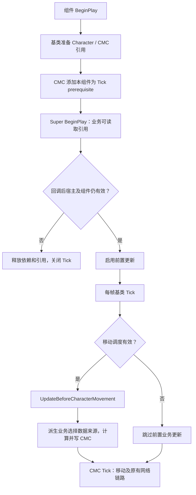
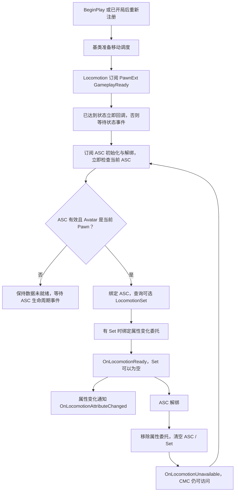
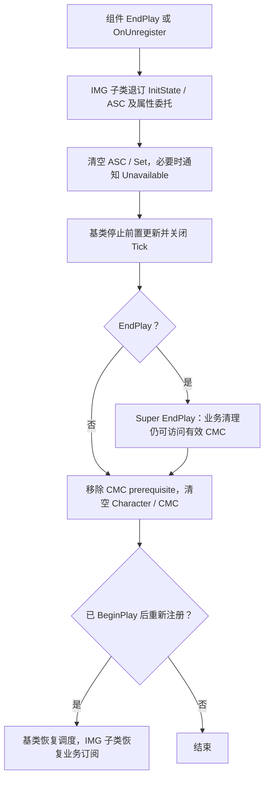
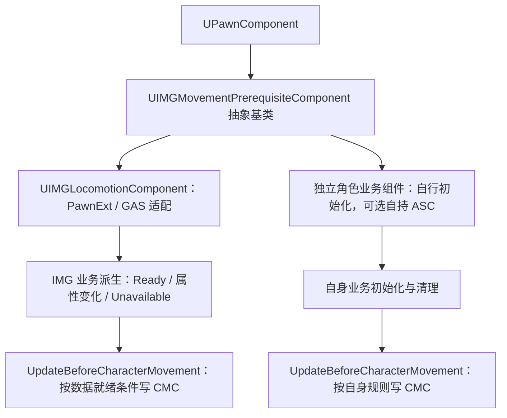

# Locomotion 分层与使用流程

## 职责

| 类型 | 职责与依赖 |
| --- | --- |
| `UIMGMovementPrerequisiteComponent` | 通用 Character/CMC 引用、前置 Tick、更新分发和生命周期清理；不依赖 PawnExt、ASC 或属性集。 |
| `UIMGLocomotionComponent` | IMG 角色的 PawnExt GameplayReady、ASC/Avatar 绑定及可选 LocomotionSet 属性订阅。 |
| 业务派生类 | 统一覆写 `UpdateBeforeCharacterMovement`，读取数据、处理意图、计算并写 CMC；自行决定业务就绪与参数恢复。 |

两个组件均在 ImagineGame 运行时模块。CMC 继续负责实际移动、姿态和网络预测，Hero Movement Intent 入口不变。基类不查询或缓存 ASC，不增加 RPC、复制或第二套移动状态。没有旧 `UpdateLocomotionPreCMC`、事件桥接或 CMC 零值回填。

## 执行流程

移动更新不等待 PawnExt 或 ASC，也不会因 ASC 解绑自动停止。需要属性的业务应检查 `IsLocomotionReady` 和 `GetLocomotionSet`；不需要属性的计算可继续。未就绪或缺少 Set 时，使用本地配置、保留当前 CMC 值或跳过对应计算由派生业务决定，C++ 不回填参数。

IMG 数据连接是另一条独立事件链：

`IsMovementPrerequisiteReady` 只表示调度有效。`IsLocomotionReady` 还要求 IMG CMC、PawnExt GameplayReady、当前 ASC/Avatar 配对有效，不保证属性或能力已复制到齐。Set 为空不阻止 Locomotion Ready。属性通知不负责最终写 CMC，最终值在统一前置更新中写入；组件不追踪 ASC 初始化之后 Set 的动态增删。

清理幂等，Unavailable 中 ASC/Set 已清空。OnUnregister 后基类 Getter 为空。组件或 Owner 正在销毁、CMC 失效/销毁、当前 CMC 已不是缓存对象时，不再分发前置业务更新。运行中替换 CMC 需要重新注册本组件；不增加每帧搜索或延迟初始化轮询。

## 派生流程

### IMG 体系

1. 派生 `UIMGLocomotionComponent`，用 `GetIMGCharacter`、`GetIMGCharacterMovementComponent` 取得具体项目类型。
2. 通过 `OnLocomotionReady`、`OnLocomotionAttributeChanged`、`OnLocomotionUnavailable` 管理业务订阅；通过 `GetIMGAbilitySystemComponent`、`GetLocomotionSet` 读取绑定数据。
3. 统一覆写 `UpdateBeforeCharacterMovement`，按 `IsLocomotionReady` 和 Set 是否存在选取数据。调度不以 GAS 就绪为门槛。
4. 业务负责清理自己的委托和临时参数；ASC/Set 解绑由 Locomotion 层处理，Character/CMC 和 Tick 依赖由基类处理。

### 不依赖 PawnExt 的体系

1. 宿主为 `ACharacter` 派生类，提供有效且具备 Tick 能力的 CMC，无须继承 `AIMGCharacter`。
2. 直接派生 `UIMGMovementPrerequisiteComponent`；共享机制放 ImagineGame，具体玩法规则放所属 Game Feature，原生派生类使用所属模块导出宏。
3. BeginPlay 中通过 `GetCharacterOwner` / `GetCharacterMovementComponent` 取得引用。基类在业务 BeginPlay 前准备引用，返回后才启用更新；BeginPlay 回调内 `IsMovementPrerequisiteReady` 尚未为真。
4. C++ 覆写 `UpdateBeforeCharacterMovement_Implementation(float DeltaTime)`；表现与移动参数计算可使用对应的 `Update Before Character Movement` 蓝图事件。基类原生实现为空。
5. 可选 ASC 由派生类通过 Owner 既有接口或引擎查询入口取得，并按自身体系管理就绪与委托。返回非空不等于 GameplayReady；基类不承担 ASC 适配。
6. 原生派生类重写生命周期时调用 Super。OnUnregister/EndPlay 业务清理在 Super 前完成；支持重新注册的原生派生类在已 BeginPlay 的 OnRegister 中恢复自己的业务订阅。

不另建 Tick、CMC 缓存或 prerequisite。多个组件各自先于 CMC，不定义彼此顺序；业务应避免同时写相同参数。

## 验证边界

本次仅进行源码、UE 5.8 接口、模块依赖与差异静态检查；未编译、未读取 Content，未验证实机网络表现。旧更新事件已删除，不提供蓝图兼容或迁移。
